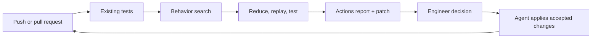

<p align="center">
  
</p>

<h1 align="center">Business rules. Executed. Explained.</h1>

<p align="center">
  <strong>Find the behavior that green tests can miss.</strong><br />
  GitHub Actions runs the checks. Engineers review the evidence and decide.
</p>

<p align="center">
  <a href="https://github.com/alpercandemir/undertow-showcase/actions/runs/44042033765">View the 8-case report</a>
  · <a href="docs/ci-behavior-review.md">CI integration</a>
  · <a href="docs/contracts.md">Approved contracts</a>
  · <a href="docs/agent-integration.md">Agent tools</a>
</p>

---

**Undertow checks whether a Java component still follows its declared business rules.** It executes bounded operation sequences, reduces a discovered failure, replays it against the same source snapshot, and produces a standalone JUnit regression test. The pipeline report shows what broke, what was expected, what actually happened, and what to review next.

No model key is required. The supported search is deterministic, and its conclusions come from executed Java and test evidence.



## One retry. Two refunds. One clear explanation.

A payment captured **2 minor units**. A refund for **1** succeeds. The caller retries the same operation.

| Step | Operation | Expected refunded total | Defective implementation |
|---:|---|---:|---:|
| 1 | Refund 1 with key `1` | 1 | 1 |
| 2 | Retry 1 with key `1` | **1** | **2** |

**Broken rule: a settled retry must have no additional effect.**

In the bundled example, all six existing tests pass. Undertow finds this two-call reproduction and generates an additional test. That test fails on the defective implementation and passes alongside the full suite on the correction.

```text
Existing suite       PASS — 6 tests
Behavior search      VIOLATION — retry_idempotency
Exact-snapshot replay REPRODUCED
Generated regression FAIL on defect → PASS on correction
Correction suite     PASS — 7 tests
Decision             Review the rule, request a fix, retain the regression
```

The implementation agent receives a ready-to-apply patch. The engineer receives a reviewable explanation.

## Eight cases. Three kinds of outcome.

Open the **[live case gallery](https://github.com/alpercandemir/undertow-showcase/actions/runs/44042033765)** and read **“Eight business-behavior cases”** in the run summary.

| Case | Business expectation | Observed outcome |
|---|---|---|
| Partial refunds and safe retries | Refund 30 + 70 of 100; retries add no effect | **PASS** |
| Preview, accept, preserve ownership | Preview is read-only; the recipient accepts safely | **PASS** |
| Double refund on retry | A settled operation must not refund again | **VIOLATION** |
| Split refunds exceed capture | Aggregate refunds stay within the captured payment | **VIOLATION** |
| Same key, different amount | A settled key remains bound to its original amount | **VIOLATION** |
| Preview transfers the ticket | Opening a preview must preserve state | **VIOLATION** |
| Another account accepts | Only the named recipient may accept | **VIOLATION** |
| Java compilation fails | Execution must finish before a behavioral verdict | **INCOMPLETE** |

The gallery is an authored demonstration: its green workflow status means **all eight outcomes matched their labels**. The five violation rows remain business-rule failures. Real candidate checks fail when a validated violation is found. [Case definitions and evidence](docs/cases/README.md).

## What the product includes

| Capability | What you get |
|---|---|
| **Automatic PR checks** | Existing suites, bounded search, replay and generated JUnit execution on the exact PR head |
| **Reduced failure scenarios** | A smaller operation sequence with the first broken rule and expected/observed state |
| **Regression proposals** | Standalone JUnit source and a patch for normal source review |
| **Before/after evidence** | Authored defect/correction checks using the identical generated test |
| **Decision reports** | Actions summaries, readable reports, JSON, replay inputs, source hashes and test logs |
| **Approved contract verification** | Exact JUnit bindings checked against trusted CI evidence: satisfied, unsatisfied or incomplete |
| **Agent integration** | Structured contract reads, read-only MCP, local preview/freshness checks and optional SARIF |
| **Approved regression evidence** | Plans for separate isolated CI execution and comparison of repeated, independently supplied test runs |

The pipeline prepares evidence and proposed tests. Owner approval, source changes and merge decisions follow normal review. Automatic code repair, automatic test commits and automatic merge are not implemented.

## The engineer's workflow

1. **Open the check.** Go to the PR's **Behavior review** result or its Actions run.
2. **Read the result.** Inspect the business rule, operation trace, existing-suite comparison and proposed test.
3. **Decide.** Request a fix, retain the regression, revise the expectation or reject the finding with a reason.
4. **Review the next run.** The implementation agent applies accepted changes; CI executes again.

Setup, search, replay and disposable adoption checks run in CI. No terminal exercise is required from the reviewing engineer. Evidence artifacts are available for deeper investigation and retained for 14 days by the supplied workflows.

| Pipeline outcome | What it establishes |
|---|---|
| No violation within budget | Existing tests passed and this bounded search found no violation |
| Violation | Replay and the generated business assertion reproduced a failure |
| Existing test failure | The baseline suite already fails; the search found no additional violation |
| Incomplete | Setup, compilation or required execution/validation did not finish |

## Supported components

| Profile | Component | Main expectations |
|---|---|---|
| `refund-cap` | `example.refunds.RefundService` | Aggregate limits, valid acceptance and unchanged state on rejection |
| `refund-retry` | `example.refunds.RefundService` | Retry idempotency and immutable operation-key amounts |
| `ticket-transfer` | `example.tickets.TicketTransfer` | Read-only previews, recipient authorization and stable ownership |

These adapters support sequential, in-memory, standalone Java/Maven components with explicit reset. A new component needs a reviewed adapter and observable rules. Concurrent or distributed behavior and automatic business-rule discovery are outside the current scope. A completed search is bounded evidence, not proof of correctness.

## Integration and development

The repository contains three focused workflows:

- **[Behavior review](.github/workflows/behavior-review.yml)** — candidate verdicts and a separate authored calibration.
- **[Behavior case gallery](.github/workflows/behavior-gallery.yml)** — the eight-case demonstration in one report.
- **[CI](.github/workflows/ci.yml)** — active implementation tests, packaged execution, archive integrity and source checks.

An implementation agent configures the owned component/profile once using the [CI integration guide](docs/ci-behavior-review.md). The [showcase integration](https://github.com/alpercandemir/undertow-showcase/pull/3) is a reviewable draft PR; its workflow runs are already available, and its default-branch merge remains pending.

<details>
<summary><strong>Maintainer tools and local verification</strong></summary>

The search runner needs Python 3.10+, Maven 3.9+ and JDK 21+. The packaged CLI and contract tools use JDK 25. Select the appropriate JDK through `JAVA_HOME`.

```sh
# With JDK 25 selected: build the active CLI and run its checks.
mvn --batch-mode --no-transfer-progress clean verify

# Prepare the owned fixtures and exercise the Python helpers.
mvn --batch-mode --no-transfer-progress -f demo/refund-extraction/pom.xml test
mvn --batch-mode --no-transfer-progress -f demo/ticket-transfer/pom.xml test
python3 -m unittest discover -s scripts/tests -v

# Verify historical recovery data and the packaged feature boundary.
python3 scripts/check-product-scope.py --jar target/undertow.jar
```

The active CLI entry points are `explore`, `contracts` and `verify`. See the [search reference](docs/explore.md), [contract guide](docs/contracts.md) and [agent integration guide](docs/agent-integration.md). These commands serve CI, implementation agents and debugging.

</details>

## A focused codebase

Hosted services, the browser playground, generic AI PR review, release gates, artifact attestation and rollout/operations tooling have been **archived and removed from active source, CLI registration, dependencies and CI execution**.

Their complete pre-cleanup source is recoverable from the [versioned archive](archive/README.md), with file-level hashes and an exact retired-path inventory. The archive is historical data and is not included in the executable JAR.

For the current execution boundaries, read [Architecture](docs/architecture.md), [Security](SECURITY.md) and [review criteria](docs/independent-review.md).
