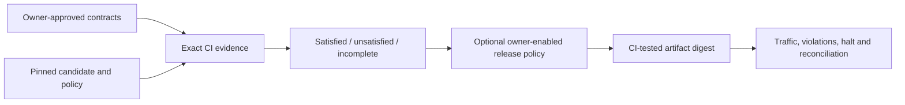
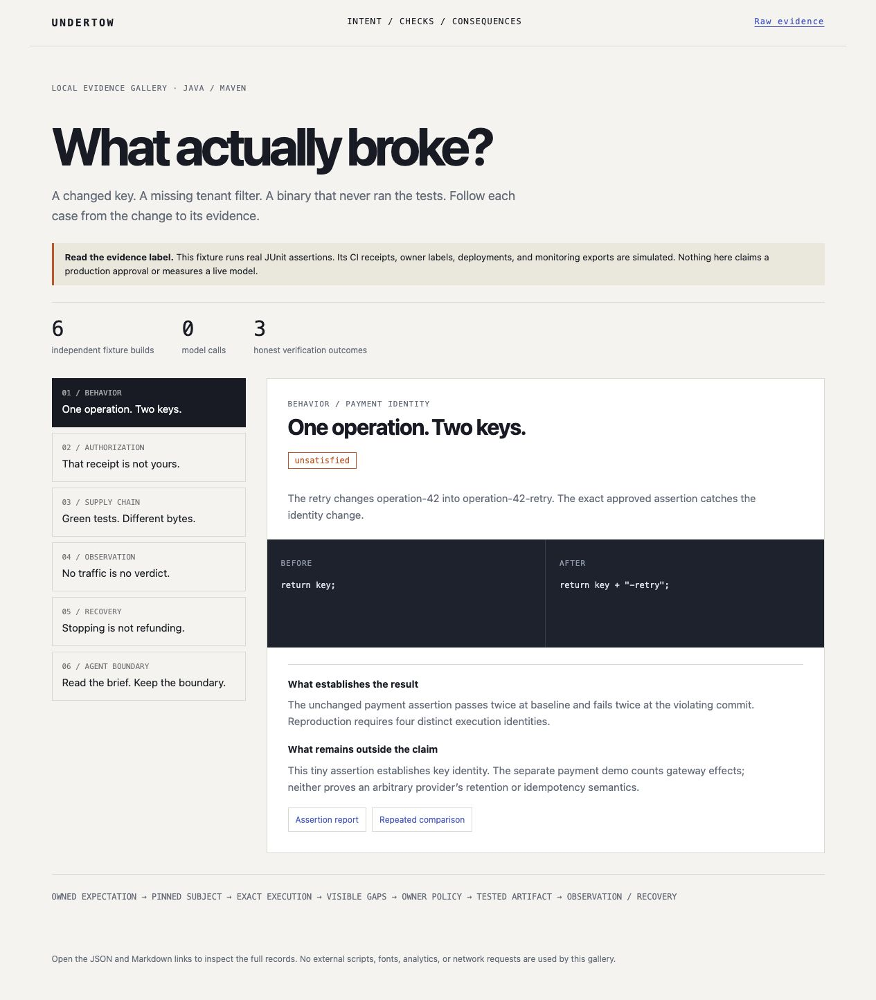

<p align="center">
  
</p>

# Undertow

**Connect engineering intent to evidence for a specific change.**

Undertow verifies owner-declared contracts against exact, independently executed checks. It tells engineers and coding agents what passed, what failed, what remains unverified, and what to do next. Optional Gemini investigation helps explain risks; deterministic verification works without a model key.

Start with payment retries, tenant isolation, order integrity, or a public API you need to preserve. Keep the tests and delivery systems you already use. Undertow connects their evidence to approved expectations and pinned Git identities.



**Scope:** Java/Maven; Java 21 source analysis; JDK 25 harness. Local previews, read-only MCP, approved regression plans, SARIF, optional gates, artifact attestations, and monitoring-export evaluation are implemented. The hosted service remains an internal preview. Synthetic exercises do not establish live-model accuracy, independent customer acceptance, or production readiness. See [current evidence and roadmap status](docs/ai-era-implementation-status.md).

[Quick start](#quick-start) · [Examples](#examples) · [Commands](#commands-and-exit-codes) · [CI and trust](docs/contracts.md) · [Advanced assurance](docs/assurance.md) · [Architecture](docs/architecture.md)

## Quick start

Requirements: JDK 25, Maven 3.9+, Git, and Python 3. Check both Java and Maven runtime selection; set `JAVA_HOME` to JDK 25 if they differ. `scripts/undertow` launches the packaged CLI and accepts a separate `UNDERTOW_JAVA_HOME` when an application uses another JDK. Direct `java -jar target/undertow.jar` remains supported.

```sh
git clone https://github.com/alpercandemir/undertow.git
cd undertow
java -version
mvn -version
mvn --batch-mode --no-transfer-progress verify
python3 -m unittest discover -s scripts/tests -v
```

Run the complete local showcase:

```sh
python3 scripts/assurance-showcase.py --output .undertow/assurance-demo
```

Open `.undertow/assurance-demo/index.html` for the interactive evidence gallery, or inspect `summary.json` and `results/fixed/contracts.md` directly. The script creates its own sample Git repository with `baseline`, `violation`, and `fixed` tags, builds six independent fixture copies, executes real JUnit assertions, and exercises the packaged CLI. It does not change this checkout's Git history or call a model, GitHub, or production service.

**Every external CI/monitoring receipt and owner label in this showcase is simulated.** The real assertions demonstrate the fixture's behavior; simulated receipts exercise trust-boundary handling. The resulting gate and recovery records are test artifacts, not production approvals. Use a new output directory on each run.

The showcase uses offline Maven after the harness build prepares its pinned dependency cache. If a required artifact is missing, prepare that dependency through your normal controlled build setup; a missing dependency is an incomplete run, not a detected defect.



## Examples

### 1. See a payment defect, its correction, and missing evidence

The showcase produces all three outcomes:

| Example | Expected result | Reason |
|---|---|---|
| `results/violation-0/contracts.md` | `unsatisfied` | The approved assertion observes a changed retry key |
| `results/fixed/contracts.md` | `satisfied` | The exact approved test passes for the corrected commit |
| `results/tenant-leak/contracts.md` | `unsatisfied` | A different tenant reaches a private receipt |
| `artifact-drift/attestation.json` | `held` | The supplied binary differs from the tested artifact |
| `results/missing/contracts.md` | `incomplete` | The required test never ran |
| `results/skipped/contracts.md` | `incomplete` | A disabled test is not success |
| `results/unrelated-green/contracts.md` | `incomplete` | Another test's pass cannot satisfy this contract |
| `results/conflicting/contracts.md` | `incomplete` | Duplicate/conflicting identities require resolution |
| `results/wrong-head/contracts.md` | `incomplete` | Evidence belongs to another commit |
| `results/infrastructure-error/contracts.md` | `incomplete` | An execution error does not reproduce a behavioral violation |

Re-run verification directly against the generated sample:

```sh
./scripts/undertow verify \
  --repo .undertow/assurance-demo/repo --base baseline --head fixed \
  --policy-commit baseline --target-head baseline \
  --ci-bundle .undertow/assurance-demo/fixtures/fixed.json \
  --ci-receipt .undertow/assurance-demo/fixtures/fixed-SIMULATED-receipt.json \
  --output .undertow/my-contract-result
```

Read `verification`, individual `checks`, and `evidence_gaps` in `contracts.json`. AI review status and release eligibility are separate records.

### 2. Add your first meaningful contract

Point the starter at your existing test and supply your own expectation:

```sh
./scripts/undertow contracts init \
  --repo /path/to/shop --repository example/shop --owner 'payments team' \
  --id PAYMENT-RETRY --expectation 'Retries preserve the logical payment key' \
  --scope src/main/java/example/PaymentGatewayAdapter.java \
  --test-id example.PaymentTest.retryPreservesKey \
  --test-source src/test/java/example/PaymentTest.java \
  --oracle pom.xml --oracle .github/workflows/ci.yml
```

This creates `.undertow/contracts.yaml` without overwriting existing policy. The bundled starter has a version and SHA-256; it supplies structure rather than business intent. Review the declaration, include all relevant helpers/resources/build controls, and commit it to your trusted target branch before using it as authority.

A contract looks like:

```yaml
schema_version: 1
repository: example/shop
oracle_paths: [pom.xml, .github/workflows/ci.yml]
oracle_roots: [src/test]
contracts:
  - id: PAYMENT-RETRY
    version: '1'
    owner: payments team
    expectation: A lost response cannot cause a retry with a different operation key.
    assumptions:
      - The gateway deduplicates this key throughout the retry window.
    scope: [src/main/java/example/PaymentGatewayAdapter.java]
    verifier: junit
    tests:
      - id: example.PaymentTest.retryPreservesKey
        sources: [src/test/java/example/PaymentTest.java]
```

Exact source bindings and optional complete oracle-root inventories detect changed, removed, renamed, or newly introduced execution controls. Maven `.mvn` controls are inventoried even when absent. A structural change requires owner review; Undertow does not assume that a rename weakens behavior.

### 3. Let an agent read the approved intent before coding

```sh
./scripts/undertow contracts list --repo /path/to/shop --base main
./scripts/undertow contracts validate \
  --repo /path/to/shop --base main --candidate feature
```

`list` returns structured JSON. Candidate validation checks a proposal without replacing trusted policy. The feature branch's `HEAD` does not become policy authority automatically.

For an MCP-compatible client, launch:

```sh
./scripts/undertow contracts mcp \
  --repo /path/to/shop --base main --head feature --policy-commit main
```

The stdio server exposes `contracts_read` and `contracts_verify`. The host pins repository, policy, and optional CI paths at startup. Tool requests cannot override those inputs, select credentials, execute code, publish, or enable a gate. Without host-bound CI evidence, verification remains incomplete. See the [MCP example](docs/assurance.md#mcp).

### 4. Check local changes before committing

```sh
./scripts/undertow contracts preview \
  --repo /path/to/shop --base main --policy-commit main \
  --path src/main/java/example/PaymentGatewayAdapter.java \
  --output .undertow/local-preview.json

./scripts/undertow contracts freshness \
  --repo /path/to/shop --base main --policy-commit main \
  --preview .undertow/local-preview.json
```

Add `--staged` to capture index content. Repeat `--path` for explicit tracked scope, or omit it for the entire index. Untracked files require explicit `--include-untracked PATH`. Previews reject sensitive paths, symlinks, unsupported content, and excessive input. Their manifest stores hashes rather than source content.

A change within the captured scope makes freshness exit `3`. Scope and policy are part of the identity. A preview stays advisory and cannot stand in for CI evidence on the final merge candidate.

### 5. Import actual CI results

Export the approved oracle identity from a trusted harness checkout, then import an administrator-approved workflow/run:

```sh
./scripts/undertow contracts export \
  --repo /path/to/shop --base BASE_SHA --head HEAD_SHA \
  --policy-commit POLICY_SHA --output /tmp/approved-contracts.json

python3 scripts/import-ci.py \
  --repository example/shop --run-id RUN_ID --workflow-id WORKFLOW_ID \
  --base BASE_SHA --head HEAD_SHA --contract-policy /tmp/approved-contracts.json \
  --output /tmp/ci-bundle.json --receipt /tmp/trusted-ci-receipt.json

./scripts/undertow verify \
  --repo /path/to/shop --base BASE_SHA --head HEAD_SHA --policy-commit POLICY_SHA \
  --ci-bundle /tmp/ci-bundle.json --ci-receipt /tmp/trusted-ci-receipt.json \
  --output .undertow/shop-verification
```

Replace uppercase placeholders with immutable commit SHAs and numeric workflow/run IDs. Import uses the existing `GITHUB_TOKEN` integration and makes explicit GitHub API requests. Verification itself needs no network or model. Keep policy exports and receipts outside candidate-controlled inputs. They are trusted local-runner assertions, not digital signatures.

The included CI retains `single-module-evidence`, `order-contract-evidence`, `customer-contract-evidence`, and corresponding tested builds. Choose the matching artifact with `--artifact-name`; do not import the mixed historical artifact as one module. See [CI setup and trust assumptions](docs/contracts.md).

### 6. Check tenant isolation, order atomicity, and API shape

Three bundled manifests show different expectations:

| Manifest | Examples |
|---|---|
| `.undertow/contracts.yaml` | Trusted policy, evidence-backed publication, workflow credential separation, no paid fallback |
| `demo/order-service/.undertow/contracts.yaml` | Observable payment effects; separate PostgreSQL order/event integrity |
| `demo/customer-service/.undertow/contracts.yaml` | Tenant authorization, many tenants sharing order IDs, declared public API shape |

Use `--manifest PATH` consistently with validate/list/export/verify. A payment unit test cannot satisfy a PostgreSQL contract. Row uniqueness cannot establish that an external gateway charged only once.

With JDK 21 selected for the application demos:

```sh
mvn -f demo/order-service/pom.xml test
mvn -f demo/order-service/pom.xml verify        # Docker/PostgreSQL required
mvn -f demo/customer-service/pom.xml verify
python3 scripts/payment-mutation.py --output .undertow/payment-mutation
python3 scripts/tenant-mutation.py --output .undertow/tenant-mutation
```

An optional real-container exercise runs the approved-oracle path with the same isolation flags used by the CI runner:

```sh
# Prepare the official pinned image and dependency cache in a controlled stage first.
python3 scripts/isolation-showcase.py --output .undertow/isolation-demo \
  --image maven@sha256:6fdc855a6ed81d288ca7ca37ac6ff5e9308b612485c0801d70b25a858c83d237 \
  --dependency-cache /path/to/prepared/maven-repository
```

It checks the unprivileged UID, lack of a default network route and host Docker socket, protected root filesystem, and absent provider/publisher variables. It does not certify every Docker host.

The reviewed mutations change the payment retry key and remove the tenant filter. Both compare two corrected passes with two relevant assertion failures under an unchanged oracle. Compilation, dependency, and infrastructure errors cannot count as detection. These checks measure verifier sensitivity, not AI precision.

### 7. Reproduce a regression independently

The full showcase's `reproduction.json` records two baseline passes and two candidate assertion failures with distinct execution identities. Use the same command with real trusted imports:

```sh
./scripts/undertow contracts reproduce \
  --repo .undertow/assurance-demo/repo --base baseline --head violation \
  --policy-commit baseline --runs .undertow/assurance-demo/reproduction-input.json \
  --contract PAYMENT-RETRY --test-id shop.PaymentTest.retryPreservesIdentity \
  --output .undertow/reproduction.json
```

For a newly proposed test, the owner first approves its source archive digest and binding. `contracts regression-plan` prepares an inert plan; the separate [isolated CI runner](docs/assurance.md#approved-regression-artifacts) checks source/oracle hashes and uses a digest-pinned image, no network, a read-only root, resource limits, and no host credentials. Generated expectations never approve themselves, and the model has no execution tool.

### 8. Export results to code scanning

Add `--sarif .undertow/contracts.sarif` to `verify`. The adapter preserves the exact test source path and candidate revision; it does not invent line numbers. Missing required evidence appears as a warning rather than disappearing into an empty result. Upload only through your trusted CI integration after checking the destination's SARIF support.

### 9. Apply a narrowly enabled release policy

Shadow verification is the default. A separate owner-approved policy can select mature contracts:

```yaml
schema_version: 1
enabled: false
owner: payments release owners
required_contracts: [PAYMENT-RETRY]
```

Commit it as `.undertow/release.yaml`. Change `enabled` only after reviewing shadow results and gate-specific tolerances. Then:

```sh
./scripts/undertow contracts release \
  --repo /path/to/shop --base BASE_SHA --head MERGE_SHA \
  --policy-commit POLICY_SHA --target-head TARGET_SHA \
  --ci-bundle /tmp/ci-bundle.json --ci-receipt /tmp/trusted-ci-receipt.json \
  --output .undertow/release-check
```

This recomputes verification; it does not trust a supplied green report. Required unknowns hold release. Temporary exceptions need an exact candidate SHA, named owner, reason, and expiry, and cannot waive incomplete evidence. The `pilot` command measures separately supplied human labels and uncertainty; it never enables a gate. See [governed release policy](docs/assurance.md#release-policies).

### 10. Follow the tested binary into rollout and recovery

A trusted build job uses `scripts/capture-build.py` to emit `build-provenance.json` alongside its test evidence. After import:

```sh
./scripts/undertow contracts attest \
  --repo /path/to/shop --base BASE_SHA --head MERGE_SHA \
  --policy-commit POLICY_SHA --target-head TARGET_SHA \
  --ci-bundle /tmp/ci-bundle.json --ci-receipt /tmp/trusted-ci-receipt.json \
  --artifact /tmp/tested-shop.jar --output .undertow/artifact-check
```

A substituted binary or a candidate missing the pinned target tip is held. `contracts rollout` recomputes that attestation and evaluates a separately trusted monitoring export against `.undertow/operations.yaml`.

The showcase walks through `accepted`, quiet-canary `held`, `halt_required`, `contained`, and `recovered`. It requires relevant traffic, freshness, exact deployment/artifact identity, timely halt confirmation, and reconciliation when external effects are irreversible. These are decisions over exported evidence; Undertow does not deploy or execute a production halt. See [operational examples](docs/assurance.md#operational-feedback).

### 11. Explore a real major dependency break

The [Spring Web 5 to 6 demo](demo/dependency-upgrade/README.md) builds three committed variants using cached historical JARs:

```sh
python3 demo/dependency-upgrade/run.py --output .undertow/spring-major-demo
```

The baseline and correction compile and run; the intervening upgrade fails on the changed `ResponseEntity` return type. That compiler failure demonstrates compatibility of these selected sources, not a reproduced JUnit assertion or a general migration guarantee.

Collect registered official notes and OSV evidence separately; this command makes network requests but uses no model:

```sh
./scripts/undertow investigate-dependency \
  --repo .undertow/spring-major-demo/repo --base base --head upgrade \
  --coordinate org.springframework:spring-web --old-version 5.3.31 --new-version 6.0.7 \
  --output .undertow/spring-major-demo/investigation.json
```

These are historical demonstration versions, not version recommendations. Literal POM inventory, retrieved migration notes, and vulnerability matches do not establish full dependency resolution, runtime compatibility, or exploitable reachability.

### 12. Add optional AI risk investigation

First try an authored offline replay:

```sh
python3 scripts/prepare-demo.py --case retry-key-unsafe --output .undertow/ai-demo
./scripts/undertow review \
  --repo .undertow/ai-demo --base HEAD~1 --head HEAD \
  --replay .undertow/ai-demo/replay.json --output .undertow/ai-review
```

Open `report.md`, `report.json`, and `evidence.json`. Replay exercises real dispatch and validation using authored responses; it does not measure live-model quality. `partial` coverage remains visible.

For a live review, configure `GEMINI_API_KEY` outside Git and follow the [setup guide](docs/phase2-setup.md). `review` without `--replay` sends bounded source/evidence to Google and may incur charges. There is no automatic provider or paid fallback. Tools are read-only; generated tests remain proposals until separately approved and executed. Mechanical formatting belongs to the build, while design, security, and business guidance remain available to investigation.

| Review mode | Use |
|---|---|
| `tools` | Bounded model investigation through approved read-only tools |
| `diff` | Diff-only model baseline |
| `collect` | Deterministic source collection without model calls |

Model findings remain advisory and cannot overwrite contract verification. Live quality, historical-PR evaluation, and independent human acceptance are separate from authored replay and mutation checks.

## Commands and exit codes

Run `./scripts/undertow COMMAND --help` or `contracts SUBCOMMAND --help` for exact options.

| Command | Purpose |
|---|---|
| `contracts init/validate/list/export` | Adopt, inspect, and export pinned intent |
| `verify [--sarif FILE]` | Shadow verification and JSON/Markdown/SARIF output |
| `contracts preview/freshness` | Fixed local content identity and invalidation |
| `contracts mcp` | Read-only agent transport over the same implementation |
| `contracts regression-plan/reproduce` | Approved external oracle plans and independent repeated comparisons |
| `contracts pilot` | Shadow measurements with separate human judgments |
| `contracts release/attest/rollout` | Owner policy, tested artifact identity, and operational evidence |
| `review`, `doctor`, `rules` | Existing optional AI review and policy setup |
| `investigate-dependency` | Dependency evidence without a model |
| `pr-info`, `publish`, `mark-stale` | Existing separately credentialed GitHub integration |
| `service`, `service-worker`, `service-publisher` | Internal hosted-service processes |

`verify` exits `0` when it writes reports, including unsatisfied/incomplete results. `freshness` exits `3` for stale content; an enabled `release` exits `3` when held; `attest`/`rollout` exit `3` when their acceptance requirements are unmet. Setup/schema errors are nonzero. Existing AI review exits `2` for final-output validation failure. Automation must inspect the structured result rather than treating every successful process exit as a clean review.

## CI, service preview, and maintenance

The included [CI workflow](.github/workflows/ci.yml) keeps ordinary builds independent of model outcomes and retains exact module evidence, tested artifact digests, and synthetic regression outputs. The [AI review workflow](.github/workflows/agent-review.yml) separates trusted harness/model work from publication credentials. Adopters can use the pinned [reusable action](action.yml) and [GitHub integration guide](docs/phase2-setup.md#githubcom-workflow-p2-02-p2-06).

The hosted implementation retains tenant isolation, encrypted state, budget accounting, workers, and separate publishers. Feature expansion is paused while core assurance develops. Try its authored worker fixture with `python3 scripts/phase3-demo.py --output .undertow/hosted-demo`; actual service setup and outstanding operational gates are in the [service guide](docs/phase3-setup.md) and [service status](docs/phase3-status.md).

```sh
mvn --batch-mode --no-transfer-progress verify
python3 -m unittest discover -s scripts/tests -v
python3 scripts/public-check.py
python3 scripts/evaluate.py --split all --output .undertow/eval-replay
```

Source navigation remains syntactic; classpath/overload resolution, Gradle, multiple modules, and broader language support are outside the current scope. A local test, clean scan, or quiet canary cannot establish global production safety. Private reports may contain source; restrict artifact access and retention. See [security](SECURITY.md), [contribution guidance](CONTRIBUTING.md), [tool contracts](docs/tool-contracts.md), and [implementation evidence](docs/ai-era-implementation-status.md).

Licensed under [MIT](LICENSE).
