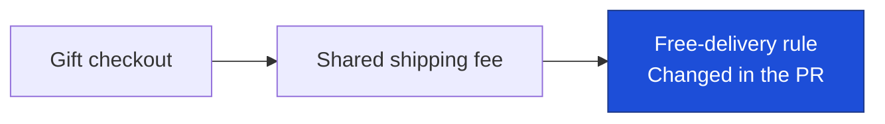

<p align="center">
  
</p>

<h1 align="center">Undertow</h1>
<p align="center"><strong>Business change reports for GitHub pull requests</strong></p>

<p align="center">
  <a href="https://github.com/alpercandemir/undertow/releases/latest"></a>
  <a href="https://github.com/alpercandemir/undertow/actions/workflows/ci.yml"></a>
</p>

Undertow reads the Git diff and explains how the application may behave after the change. Each finding describes the affected flow, shows the same scenario before and after, and links to the source at both commits.

## See a real report

In the showcase, one line changes free-delivery eligibility from `order_total > 50` to `order_total >= 50`.

| Scenario | Before | After |
| --- | --- | --- |
| An order totals $50 | The order is ineligible for free delivery | The order qualifies for free delivery |

The Action also found two unchanged callers that could be affected by the edit.



[Read the bot's PR report](https://github.com/alpercandemir/undertow-showcase/pull/5#issuecomment-7037780019) · [See the one-line diff](https://github.com/alpercandemir/undertow-showcase/pull/5/files) · [View the CI run](https://github.com/alpercandemir/undertow-showcase/actions/runs/44724616897)

## Add it to GitHub Actions

Copy the [ready-to-use workflow](docs/examples/change-review.yml) into `.github/workflows/undertow.yml`. The workflow runs when a PR opens or changes. Its Undertow step uses the published Action.

```yaml
- uses: alpercandemir/undertow/actions/change-review@v0.2.1
  with:
    comment: 'true'
```

Undertow writes a job summary and saves Markdown and JSON reports. With comments enabled, `github-actions[bot]` creates or updates one PR comment using the workflow token. Findings are advisory.

## How the analysis works

- **Built-in analysis** compares common numeric rules, literal return values, and HTTP route declarations. It searches both Git revisions for potential callers up to three steps away, including files outside the diff.
- **Optional Gemini analysis** uses an Actions secret named `GEMINI_API_KEY` to interpret more complex flows across languages and files. It receives selected source excerpts and related context.

[Integration guide and analysis limits](docs/change-review.md)
