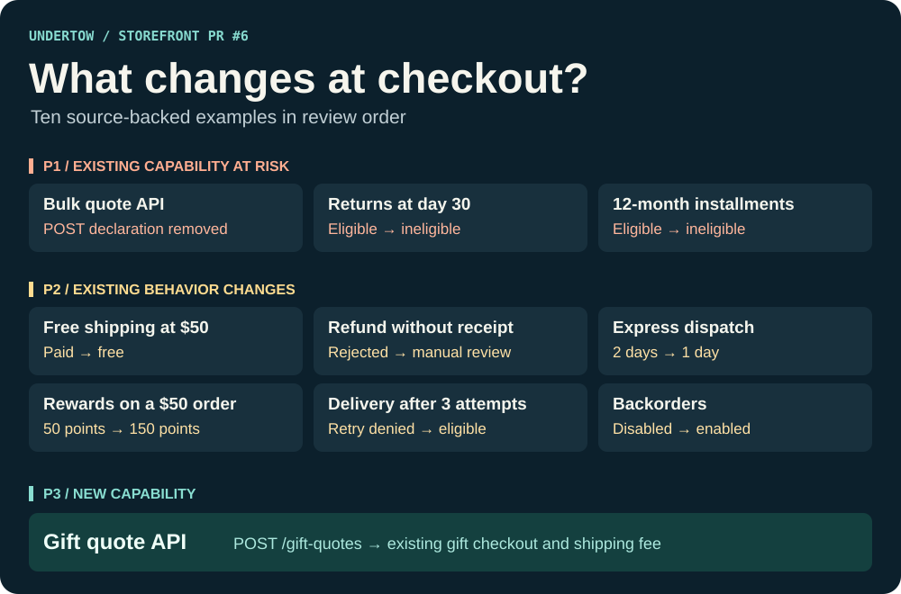

<p align="center">
  
</p>

<h1 align="center">Undertow</h1>
<p align="center"><strong>See what a pull request changes for customers</strong></p>

<p align="center">
  <a href="https://github.com/alpercandemir/undertow/releases/latest"></a>
  <a href="https://github.com/alpercandemir/undertow/actions/workflows/ci.yml"></a>
</p>

Undertow reviews a pull request and shows which customer or client could get a different outcome. Its GitHub comment gives you a scenario to check, the before and after outcomes inferred from source, and links to the code behind them.

[Try a product review](#try-a-product-review) · [Historical benchmark](#historical-benchmark) · [Install the Action](#get-a-report-on-your-next-pr) · [Supported changes](#supported-changes)

## Same cart, different total

A PR changes the free-shipping rule from **over $50** to **$50 or more**. The report singles out the customer with exactly $50 in their cart. At $49 and $51, the two revisions agree.

| At a $50 subtotal | Before | After |
| --- | ---: | ---: |
| Shipping fee | $7 | $0 |
| Gift checkout total | **$57** | **$50** |

**Review question** · Should a gift order qualify for free delivery the moment it reaches $50?

The bot comment shows the change in shipping eligibility. The dollar amounts follow from the shipping and checkout code linked in that comment. [Read the actual PR comment](https://github.com/alpercandemir/undertow-showcase/pull/5#issuecomment-7037780019)

<details>
<summary>Reproduce the $50 finding locally with Python and Git</summary>

From a checkout of Undertow's `main` branch, run these commands with Python 3.11+ and Git. The worker reads the showcase's committed source from a bare repository. Local mode uses no model key.

```sh
mkdir -p .undertow
git clone --bare https://github.com/alpercandemir/undertow-showcase.git .undertow/showcase.git
git -C .undertow/showcase.git fetch origin refs/pull/5/head
env -u GEMINI_API_KEY python3 actions/change-review/review_engine.py \
  --repo .undertow/showcase.git \
  --base 7f831b0d911228ba608bfb9f9ab553933190348e \
  --head 1aee946a9ad10474b6971acc909fd29b6d70f261 \
  --source-url https://github.com/alpercandemir/undertow-showcase \
  --output .undertow/shipping-review
cat .undertow/shipping-review/summary.md
```

Open `report.json` in the same output directory for the input, both inferred outcomes, the `source_inferred` evidence level, and the source lines behind the comparison.

</details>

## Try a product review

Two showcase PRs cover **10 distinct scenarios**. The shipping example above isolates one rule. The storefront release below shows what happens when several rules change together. Pick a customer scenario, then expand its finding in the PR comment. [Open the storefront report](https://github.com/alpercandemir/undertow-showcase/pull/6#issuecomment-7039643058)

| Scenario | Before → after | What to decide |
| --- | --- | --- |
| **Return on day 30** | Eligible → return window expired | Which return window applies to orders already placed? |
| **Refund without a receipt** | Rejected → manual review | Who handles the requests that enter the queue? |
| **Gift quote for a $50 cart** | No gift-quote route declared → new gift-quote route | Which clients should get access at launch? |
| **Bulk quotes** | Route declared → declaration removed | Which integrations still need time to migrate? |

<p align="center">
  <a href="https://github.com/alpercandemir/undertow-showcase/pull/6#issuecomment-7039643058">
    
  </a>
</p>

<details>
<summary>Explore six more scenarios from the same release</summary>

| What to try | Before → after | Product question |
| --- | --- | --- |
| Choose a 12-month payment plan | Eligible → ineligible | When should checkout stop offering 12 months? |
| Quote a $50 cart | $7 shipping → free shipping | Should an order for exactly $50 qualify? |
| Ask for an express dispatch estimate | 2 days → 1 day | Can fulfillment meet the new estimate? |
| Earn points on a $50 order | 50 → 150 points | When should the new earn rate take effect? |
| Retry after three failed delivery attempts | Ineligible → eligible | How many attempts should support allow? |
| Check whether an item can be backordered | Disabled → enabled | What availability should checkout show? |

</details>

The report infers outcomes from Git revisions. Shipping and rewards amounts follow the calculations in the caller. Route findings identify declarations. The actual HTTP response depends on the handler and deployment. [Storefront source at the reported revision](https://github.com/alpercandemir/undertow-showcase/blob/856a37f063cb9ad4cf90a76323a32009991a3568/src/storefront.py)

## Get a report on your next PR

Add the example workflow at `.github/workflows/undertow.yml` on your base branch. It includes the PR trigger, permissions, and this step pinned to the published release. [Copy the workflow](docs/examples/change-review.yml)

```yaml
- uses: alpercandemir/undertow/actions/change-review@v0.3.0
  with:
    comment: 'true'
```

Open or update a PR. The workflow writes an Actions summary, saves Markdown and JSON reports, and updates one bot comment. The structured report examples show the format on `main`. [Markdown example](docs/examples/summary.md) · [JSON example](docs/examples/report.json)

## Supported changes

| Source change | What Undertow can show |
| --- | --- |
| An eligibility threshold moves from 30 to 14 days, including a supported named constant or multiline condition | The day-30 return changes from eligible to ineligible. The finding links to the source on both revisions. |
| An eligible refund without a receipt changes status | The finding shows the old and new return values. |
| An HTTP route is added or removed | The finding identifies the method and path. |
| Other code calls the edited rule | The trace follows callers for up to three steps and labels resolved calls and possible name matches. |

The Action reads Git source. Optional Gemini analysis sends selected source excerpts to Google to interpret related edits. Both modes produce source-based findings. See the guide for supported patterns, evidence labels, and coverage limits. [Analysis and configuration](docs/change-review.md) · [Controlled test cases](evaluation/README.md#controlled-fixtures-and-known-limitations)

## Historical benchmark

**20 merged PRs · 18 known behavior changes · 4 behavior-preserving controls**

The corpus contains ten Click PRs and ten HTTPX PRs. Nine PRs fixed bugs, seven changed behavior intentionally, and four preserved runtime behavior. One additional Click regression was scored separately. [Case manifest](evaluation/historical.json) · [Full benchmark](evaluation/benchmark.md)

| Review setup | PRs completed in that mode | Known changes found across all 20 PRs |
| --- | ---: | ---: |
| Undertow local rules | 20 / 20 | 0 / 18 |
| **Undertow + `gemini-3.1-flash-lite`** | **11 / 20** | **8 / 18** |
| GitHub Copilot CLI | 20 / 20 | 15 / 18 |

In Click #2604, a function called `my_sync_command` generated the command **`my-sync-command` → `my-sync`**. Undertow's report links that change to scripts that still call the old name. Copilot missed this labeled rename. [Example report](evaluation/results/historical-gemini/click-2604/report.json)

On the 11 PRs where both model-backed reviews ran, Undertow with Gemini identified 8 of 11 labeled changes, and Copilot identified 9. The Gemini report gave 1 accurate before/after example out of 10, compared with 12 out of 18 for Copilot on those same PRs. Seven other PRs fell back to local rules and two had no reviewable source regions. The local rules found zero labeled changes across the corpus. All 18 fell outside the local baseline's declared patterns. [Results and scoring](evaluation/benchmark.md#measured-results-on-the-frozen-20-prs)

| From the benchmark | Before → after | Result |
| --- | --- | --- |
| [HTTPX #3367](https://github.com/encode/httpx/pull/3367) · JSON validation | A request body with NaN was serialized → serialization raises an error. | Both model-backed reviews identified all three labeled JSON changes in this PR. |
| [HTTPX #3387](https://github.com/encode/httpx/pull/3387) · Refactor control | Helpers move while header and response handling stays the same. | Gemini reported a private-helper move as a finding. Local rules and Copilot issued no findings. |
| [Click #2934](https://github.com/pallets/click/pull/2934) · Supplemental regression | A command reading a line from standard input exits normally → aborts at end of input. | Gemini identified the iterator exception change. Copilot connected it to the command abort. Scored separately. |

<details>
<summary>Browse all 20 benchmark PRs</summary>

Each fraction shows how many of the labeled changes the reviewer identified. A control has no labeled change to detect. Fallback and cases with no source regions are shown separately for the Gemini run.

| PR | Behavior covered | Known changes | Undertow local | Copilot CLI | Undertow + Gemini |
| --- | --- | ---: | ---: | ---: | ---: |
| [Click #2365](https://github.com/pallets/click/pull/2365) | Respect the choice-display setting in help. | 1 | 0 / 1 | 1 / 1 | Local fallback |
| [Click #2604](https://github.com/pallets/click/pull/2604) | Trim decorator suffixes from generated command names. | 1 | 0 / 1 | 0 / 1 | 1 / 1 |
| [Click #2680](https://github.com/pallets/click/pull/2680) | Run close callbacks when explicitly exiting a context. | 1 | 0 / 1 | 1 / 1 | 1 / 1 |
| [Click #2846](https://github.com/pallets/click/pull/2846) | Escape completion values containing colons when Zsh emits a description. | 1 | 0 / 1 | 1 / 1 | 1 / 1 |
| [Click #2930](https://github.com/pallets/click/pull/2930) | Set implicit flag values when a type is supplied. | 1 | 0 / 1 | 1 / 1 | 0 / 1 |
| [Click #2935](https://github.com/pallets/click/pull/2935) | Use the current nested group when resolving completion. | 1 | 0 / 1 | 1 / 1 | 0 / 1 |
| [Click #2972](https://github.com/pallets/click/pull/2972) | Omit the environment hint when no variable is configured. | 1 | 0 / 1 | 1 / 1 | 1 / 1 |
| [Click #2990](https://github.com/pallets/click/pull/2990) | Type annotations expand to match existing exception formatting. The runtime formatting path is unchanged. | 0 | Control | Control | Control |
| [Click #3004](https://github.com/pallets/click/pull/3004) | Render the Enum member name as the displayed option default. | 1 | 0 / 1 | 1 / 1 | Local fallback |
| [Click #3009](https://github.com/pallets/click/pull/3009) | Changelog entry only. The referenced StreamMixer fix landed in a separate PR. | 0 | Control | Control | No source regions |
| [HTTPX #2998](https://github.com/encode/httpx/pull/2998) | Drop the spurious final empty string from text streaming. | 1 | 0 / 1 | 0 / 1 | 0 / 1 |
| [HTTPX #3116](https://github.com/encode/httpx/pull/3116) | Apply the client timeout to manually constructed requests. | 1 | 0 / 1 | 1 / 1 | Local fallback |
| [HTTPX #3178](https://github.com/encode/httpx/pull/3178) | Accept the socks5h proxy scheme. | 1 | 0 / 1 | 1 / 1 | 1 / 1 |
| [HTTPX #3364](https://github.com/encode/httpx/pull/3364) | Explicit request params replace the query in the URL. | 1 | 0 / 1 | 1 / 1 | Local fallback |
| [HTTPX #3367](https://github.com/encode/httpx/pull/3367) | Change JSON byte serialization and reject non-finite numbers. | 3 | 0 / 3 | 3 / 3 | 3 / 3 |
| [HTTPX #3373](https://github.com/encode/httpx/pull/3373) | Change escaping for query parameters passed as key-value pairs. | 1 | 0 / 1 | 1 / 1 | Local fallback |
| [HTTPX #3375](https://github.com/encode/httpx/pull/3375) | Removes a test case. The library source is unchanged. | 0 | Control | Control | No source regions |
| [HTTPX #3377](https://github.com/encode/httpx/pull/3377) | Load optional runtime modules at their point of use. | 1 | 0 / 1 | 0 / 1 | Local fallback |
| [HTTPX #3378](https://github.com/encode/httpx/pull/3378) | Narrow the Request method parameter to strings. | 1 | 0 / 1 | 1 / 1 | Local fallback |
| [HTTPX #3387](https://github.com/encode/httpx/pull/3387) | Moves internal utility functions and their tests. Public header and response processing retain equivalent calls. | 0 | Control | Control | Control |

[Per-case inputs and expected outcomes](evaluation/historical.json) · [Gemini reports and assessments](evaluation/results/historical-gemini/) · [Copilot assessments](evaluation/results/historical-copilot-adjudications.json)

</details>

<details>
<summary>Recompute the benchmark scores</summary>

Run from the repository root with Python 3.11+. The checked-in runs can be scored without provider credentials.

```sh
python3 evaluation/run.py score evaluation/results/historical-local.json
python3 evaluation/run.py score evaluation/results/historical-copilot.json \
  --adjudications evaluation/results/historical-copilot-adjudications.json
python3 evaluation/run.py score evaluation/results/historical-gemini/run.json \
  --adjudications evaluation/results/historical-gemini/adjudications.json
```

The detailed report includes example accuracy, precision, false positives, timing, provider costs, and evaluation limits. [Detailed results](evaluation/benchmark.md) · [Rerun the benchmark](evaluation/competitive-pilot.md)

</details>
