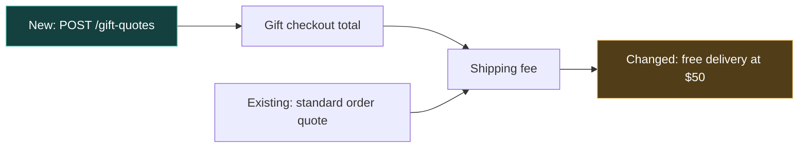

<p align="center">
  
</p>

<h1 align="center">Undertow</h1>
<p align="center"><strong>See which customer gets a different outcome after a pull request</strong></p>

<p align="center">
  <a href="https://github.com/alpercandemir/undertow/releases/latest"></a>
  <a href="https://github.com/alpercandemir/undertow/actions/workflows/ci.yml"></a>
</p>

## One character takes $7 off a gift order

```diff
-    if order_total > 50:
+    if order_total >= 50:
```

At $49 and $51, both revisions agree. **Exactly $50** is the cart a reviewer needs to try. In the showcase PR, Undertow identifies that input and links the eligibility rule to the shipping fee and the gift checkout that uses it.

| At a $50 subtotal | Before | After |
| --- | ---: | ---: |
| Qualifies for free delivery | `False` | `True` |
| Shipping fee | $7 | $0 |
| Gift checkout total | **$57** | **$50** |

**Review question** · Should a gift order qualify for free delivery the moment it reaches $50?

The bot comment reports the eligibility change from source. Following its two caller links explains the dollar amounts above. [Read the actual PR comment](https://github.com/alpercandemir/undertow-showcase/pull/5#issuecomment-7037780019)

<details>
<summary>Reproduce the $50 finding locally with Python and Git</summary>

From a checkout of Undertow's `main` branch, run these commands with Python 3.11+ and Git. The worker reads the showcase's committed source from a bare repository. Local mode uses no model key.

```sh
mkdir -p .undertow
git clone --bare https://github.com/alpercandemir/undertow-showcase.git .undertow/showcase.git
git -C .undertow/showcase.git fetch origin refs/pull/5/head
env -u GEMINI_API_KEY python3 actions/change-review/review_engine.py \
  --repo .undertow/showcase.git \
  --base 7f831b0d911228ba608bfb9f9ab553933190348e \
  --head 1aee946a9ad10474b6971acc909fd29b6d70f261 \
  --source-url https://github.com/alpercandemir/undertow-showcase \
  --output .undertow/shipping-review
cat .undertow/shipping-review/summary.md
```

Open `report.json` in the same output directory for the input, both inferred outcomes, the `source_inferred` evidence level, and the source lines behind the comparison.

</details>

## One storefront release, ten business changes


The storefront showcase changes ten policies and entry points in one PR. Expand the table to see a concrete review case for each. [Read the storefront PR comment](https://github.com/alpercandemir/undertow-showcase/pull/6#issuecomment-7039643058)

<details>
<summary>Inspect all ten storefront changes</summary>

The table follows the store's policies through their callers. For example, the engine identifies a rewards multiplier changing from 1 to 3. The 150-point total comes from following the order quote's multiplication for a $50 cart. [Storefront source](https://github.com/alpercandemir/undertow-showcase/blob/626622ca0752042e698487cf9cae7d67ed90c1f1/src/storefront.py)

| Review | Try this input | Before → after | Where to look |
| --- | --- | --- | --- |
| P1 | A client posts a list of order totals to `/bulk-quotes` | Route declared → declaration removed | Bulk pricing clients |
| P1 | Return an item 30 days after delivery | Eligible → window expired | Refund intake |
| P1 | Request a 12-month payment plan | Eligible → ineligible | Installment offers |
| P2 | Quote a $50 cart | $7 shipping → free shipping | Standard and gift checkout |
| P2 | Submit an eligible refund without a receipt | Rejected → manual review | Refund state |
| P2 | Request an express dispatch estimate | 2 days → 1 day | Order quote |
| P2 | Earn points on a $50 order | 50 → 150 points | Quote uses points per dollar |
| P2 | Retry after three delivery attempts | Ineligible → eligible | Delivery retry decision |
| P2 | Ask whether an item can be backordered | Disabled → enabled | Backorder field in the order quote |
| P3 | Post a $50 order to `/gift-quotes` | New route on the head revision, returning a $50 gift total | Existing gift checkout and shipping policy |

</details>

### Why a reviewer should open the gift quote finding

The new endpoint reuses `gift_checkout_total`. That function adds the shipping fee to the subtotal, and the fee depends on the edited free-delivery rule. At exactly $50, the existing gift calculation changes from $57 to $50. The newly added endpoint exposes that same calculation. An order for $51 would hide the boundary change.



Undertow follows possible callers up to three steps beyond an edited method. The report on `main` distinguishes a statically resolved call from a possible name match on each revision. The reviewer can follow those links to see how a caller uses the result. [Explore the smaller one-line shipping PR](https://github.com/alpercandemir/undertow-showcase/pull/5#issuecomment-7037780019)

<details>
<summary>See the underlying patterns in Java, Go and TypeScript</summary>


These small Git comparisons were run with the built-in analysis in v0.2.1. The examples below summarize what it found.

### A refund arrives without a receipt · Java

```diff
     if (receiptMissing) {
-        return "REJECTED";
+        return "MANUAL_REVIEW";
     }
```

The same refund now leaves the policy with the state `MANUAL_REVIEW`. The return statement is enough to establish that change. To find out whether someone actually receives a review task, follow the caller that consumes the state.

### A delivery has already been attempted three times · Go

```diff
-    return attempts < 3
+    return attempts < 5
```

At `attempts = 3`, the old retry check returns `false` and the new one returns `true`. That gives the reviewer a concrete case where another attempt becomes eligible. A first-attempt example would give the same answer on both revisions.

### A returns endpoint appears · TypeScript

```diff
+router.post("/returns", createReturn);
```

For a client sending `POST /returns`, the head revision now declares a route to `createReturn`. The report links to the new declaration. The handler determines which requests succeed and what the client receives.

A fourth comparison added only a comment above an unchanged Python delivery fee. Undertow produced an empty findings list. Each report includes its reviewed scope so a reader can see what was examined.

</details>

## Get a report on your next PR

The workflow below uses the tagged release `v0.3.0`. The local walkthrough above uses the structured report format on `main`. [Sample Markdown report](docs/examples/summary.md) · [Sample JSON](docs/examples/report.json)

Copy the [ready-to-use workflow](docs/examples/change-review.yml) into `.github/workflows/undertow.yml` on your base branch. It includes the PR trigger, token permissions, and this Action step.

```yaml
- uses: alpercandemir/undertow/actions/change-review@v0.3.0
  with:
    comment: 'true'
```

Open a PR or push another commit to it. The job writes an Actions summary and saves `summary.md` and `report.json`. With comments enabled, `github-actions[bot]` updates one comment using the workflow token. The PR description can be empty. Findings are advisory. [Open the showcase CI run](https://github.com/alpercandemir/undertow-showcase/actions/runs/44724616897)

## What goes into a finding?

**Built-in analysis** runs on the GitHub runner. It recognizes common numeric conditions, changed literal returns, and HTTP route declarations. For recognized methods it searches both source trees and follows possible callers up to three steps. A same-name match is a lead for the reviewer, especially in code that uses dynamic dispatch.

**Optional Gemini analysis** interprets changes that span languages or files. When you pass `GEMINI_API_KEY` to the Action, it sends Google selected source excerpts and caller context. Gemini can request more surrounding code or look up identifiers already present in the review. Each accepted finding cites a changed region. The examples describe outcomes inferred from source. [Configuration, data sharing, and analysis limits](docs/change-review.md)

## How did it do on historical PRs?

On 20 merged Click and HTTPX PRs, the local rules surfaced **0 of 18** labeled behavior changes. Copilot CLI surfaced **15 of 18** in the same comparison. All 18 outcomes fell outside the local patterns declared for the benchmark. The storefront demonstrates those supported patterns in a controlled example. Independent maintainer assessment and the Gemini comparison are pending. [Evaluation results and limitations](evaluation/goal4-validation.md) · [Reproduce the benchmark](evaluation/competitive-pilot.md)
