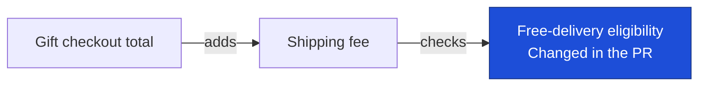

<p align="center">
  
</p>

<h1 align="center">Undertow</h1>
<p align="center"><strong>Business change reports for GitHub pull requests</strong></p>

<p align="center">
  <a href="https://github.com/alpercandemir/undertow/releases/latest"></a>
  <a href="https://github.com/alpercandemir/undertow/actions/workflows/ci.yml"></a>
</p>

A shopper puts exactly $50 in their cart. Does shipping still cost $7? In the [showcase PR](https://github.com/alpercandemir/undertow-showcase/pull/5/files), the answer turns on a single character.

```diff
-    if order_total > 50:
+    if order_total >= 50:
```

Undertow reads the two Git revisions, finds an input that illustrates the changed rule, and posts the before-and-after result in the PR. It also looks for callers in the rest of the repository. [Read the live bot comment](https://github.com/alpercandemir/undertow-showcase/pull/5#issuecomment-7037780019)

## Follow the $50 order

| What the reviewer can inspect | Before | After |
| --- | --- | --- |
| Free-delivery eligibility at exactly $50 | `False` | `True` |
| Shipping fee implied by the checkout code | $7 | $0 |
| Gift checkout total implied by that fee | $57 | $50 |

The first row is the example Undertow reported. The other two come from following its source links. Both checkout functions stayed untouched in the PR. The shipping function reads the eligibility result, and gift checkout adds the resulting fee to the order total. [Shipping calculation](https://github.com/alpercandemir/undertow-showcase/blob/1aee946a9ad10474b6971acc909fd29b6d70f261/src/checkout.py#L4-L5) · [Gift checkout](https://github.com/alpercandemir/undertow-showcase/blob/1aee946a9ad10474b6971acc909fd29b6d70f261/src/gift_checkout.py#L4-L5)



## Three more changes through a reviewer's eyes

These small Git comparisons were run with the built-in analysis in v0.2.1. The examples below summarize what it found.

### A refund arrives without a receipt · Java

```diff
     if (receiptMissing) {
-        return "REJECTED";
+        return "MANUAL_REVIEW";
     }
```

The same refund now leaves the policy with the state `MANUAL_REVIEW`. The return statement is enough to establish that change. To find out whether someone actually receives a review task, follow the caller that consumes the state.

### A delivery has already been attempted three times · Go

```diff
-    return attempts < 3
+    return attempts < 5
```

At `attempts = 3`, the old retry check returns `false` and the new one returns `true`. That gives the reviewer a concrete case where another attempt becomes eligible. A first-attempt example would give the same answer on both revisions.

### A returns endpoint appears · TypeScript

```diff
+router.post("/returns", createReturn);
```

For a client sending `POST /returns`, the head revision now declares a route to `createReturn`. The report links to the new declaration. The handler determines which requests succeed and what the client receives.

A fourth comparison added only a comment above an unchanged Python delivery fee. Undertow produced an empty findings list. Each report includes its reviewed scope so a reader can see what was examined.

## Get a report on your next PR

Copy the [ready-to-use workflow](docs/examples/change-review.yml) into `.github/workflows/undertow.yml` on your base branch. It includes the PR trigger, token permissions, and this Action step.

```yaml
- uses: alpercandemir/undertow/actions/change-review@v0.2.1
  with:
    comment: 'true'
```

Open a PR or push another commit to it. The job writes an Actions summary and saves `summary.md` and `report.json`. With comments enabled, `github-actions[bot]` updates one comment using the workflow token. The PR description can be empty. Findings are advisory. [Open the showcase CI run](https://github.com/alpercandemir/undertow-showcase/actions/runs/44724616897)

## What goes into a finding?

**Built-in analysis** runs on the GitHub runner. It recognizes common numeric conditions, changed literal returns, and HTTP route declarations. For recognized methods it searches both source trees and follows possible callers up to three steps. A same-name match is a lead for the reviewer, especially in code that uses dynamic dispatch.

**Optional Gemini analysis** interprets changes that span languages or files. When you pass `GEMINI_API_KEY` to the Action, it sends Google selected source excerpts and caller context. Gemini can request more surrounding code or look up identifiers already present in the review. Each accepted finding cites a changed region. The examples describe outcomes inferred from source. [Configuration, data sharing, and analysis limits](docs/change-review.md)
