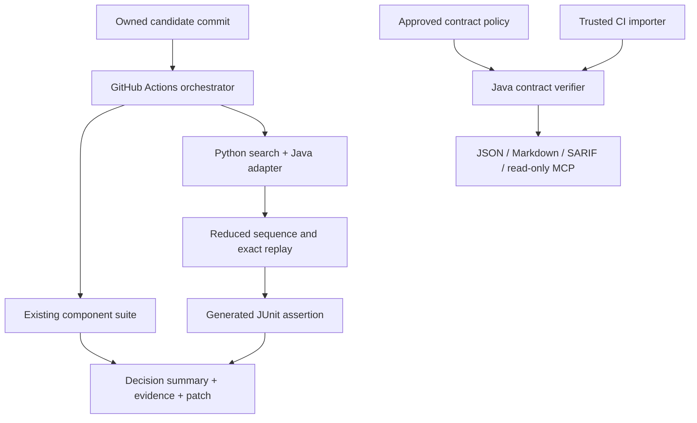

# Architecture

Undertow has two execution paths with distinct authority: behavior exploration executes selected component code; contract verification reads approved definitions and existing CI evidence.

## Behavior exploration

`scripts/behavior-review.py` coordinates a clean existing-suite run, search, replay and exported JUnit execution. `experiments/behavior-search/` contains the seeded generators, independent expectations, reducer and bounded Java transport. The frozen shared core is recorded in `strategy-lock.json`.

Each adapter resets its component and reads actual state. The runner snapshots source, records source/tool identities and keeps build failures separate from business violations. A reproduced finding yields a standalone test draft and a repository-relative patch. Authored calibration additionally checks the same draft against a correction and its full suite. `scripts/behavior-gallery.py` aggregates eight labeled examples into one readable report without feeding labels or walkthroughs into search.

The Java CLI bundles the Python runtime and owned examples for `explore`. Source checkouts can run the Python wrapper directly. Java/Maven execution is limited to selected compatible components; the runner is not an arbitrary-repository sandbox.

## Contract verification and agents

The JDK 25 CLI uses Spring Boot for non-web application lifecycle and picocli for commands. Only `explore`, `contracts` and `verify` are registered. Every invocation gets fresh option state, and Spring reads only bundled `undertow.properties` rather than reviewed working-directory configuration.

`ContractPolicy` reads a host-pinned manifest and oracle inventory from Git objects. `scripts/import-ci.py` validates independently produced GitHub evidence. `ContractVerifier` binds exact tests and evidence to the approved policy and emits satisfied, unsatisfied or incomplete outcomes. It performs no source execution or model request.

`ContractMcp` exposes only `contracts_read` and `contracts_verify`; requests cannot override host-bound policy or evidence. `LocalPreview` captures working/staged content identity for agent freshness checks. `RegressionEvidence` prepares approved external-oracle plans and compares repeated executions from a separate runner. `ContractSarif` exports existing verification findings without inventing source locations.

## Source layout

| Path | Responsibility |
|---|---|
| `.github/workflows/` | Candidate review, eight-case gallery and active build verification |
| `experiments/behavior-search/` | Search, expectations, reduction, Java adapters and fixed strategy record |
| `scripts/` | CI orchestration, evidence import, packaging and source checks |
| `src/main/java/dev/undertow/cli/` | Active CLI and runtime extraction |
| `src/main/java/dev/undertow/contracts/` | Approved policy, verification, agent reads and regression evidence |
| `src/main/java/dev/undertow/tools/` | Immutable Git reads and CI evidence validation |
| `demo/refund-extraction/`, `demo/ticket-transfer/` | Supported owned fixtures |
| `archive/` | Immutable historical source; never executed or packaged |

Hosted service/database code, model clients, generic review/publication, release/rollout evaluators and the browser UI are absent from active source. H2, Jsoup, JavaParser and the Gemini SDK were removed from direct dependencies. CI checks the archive and built JAR to prevent accidental reintroduction of retired implementations.
